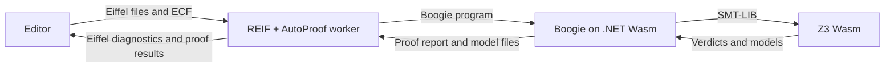

# CodeForge architecture

CodeForge is an Eiffel editor with examples, shareable projects, library browsing, and AutoProof verification.

## Browser verification

REIF compiles Eiffel and AutoProof translates contracts to a Boogie program. Boogie builds verification conditions, Z3 solves them, and AutoProof maps the result back to Eiffel features and source lines.

Workers keep the editor responsive. The bridge passes Boogie output and models back to REIF through shared memory. The static host needs cross-origin isolation. GitHub Pages uses `pages/coi.js` to supply it.

## Execution and hosting

- **Verify** starts Boogie and Z3 while REIF checks Eiffel and generates the Boogie program.
- **Compile** runs REIF, then Clang and LLD in browser workers. The output is a Wasm module linked against the Eiffel runtime. **Run** executes that module in a separate worker. The editor reuses the last compiled module until its inputs change.
- Pages builds that omit either Wasm component use the versioned VM for the corresponding operation. The browser caches the VM on first use.
- The standalone FastAPI deployment runs the Eiffel toolchain in per-session Docker containers.

See [deployment](DEPLOYMENT.md) and [REIF's browser implementation](https://github.com/risajef/reif/tree/Exp-browser-autoproof/research/browser).
